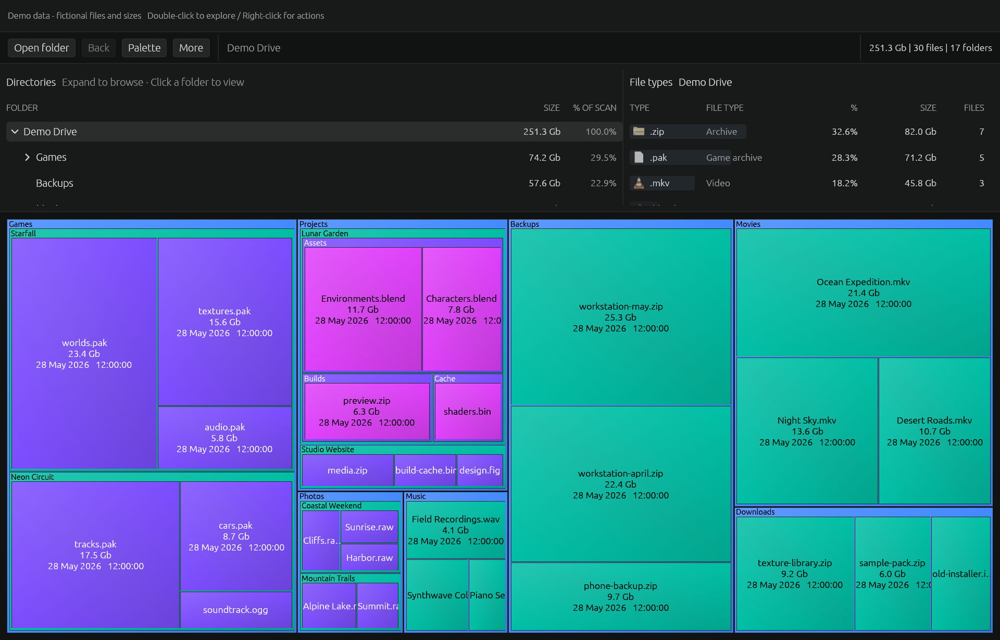
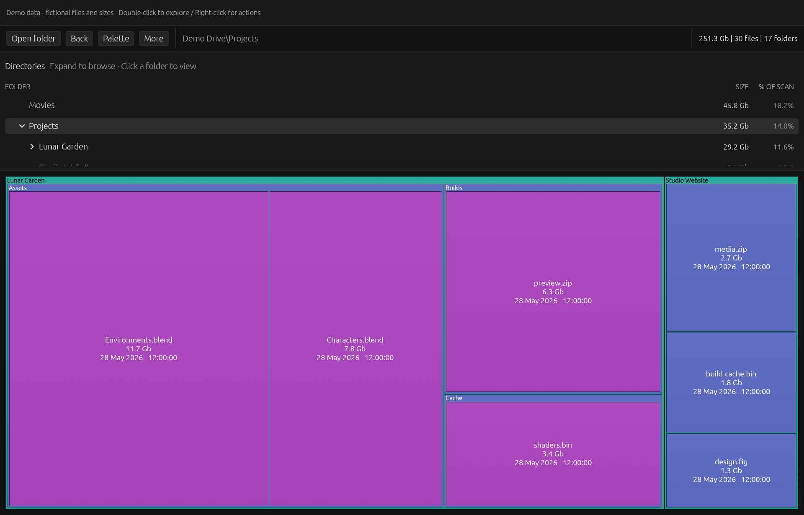
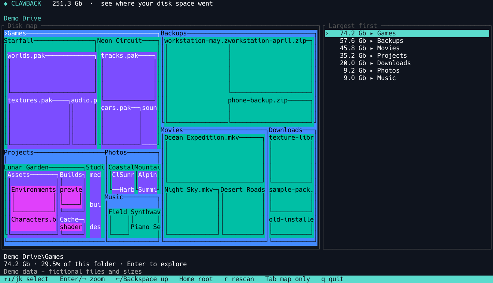

# Clawback

[](https://github.com/Azazel-Labs/Clawback/actions/workflows/ci.yml)
[](https://github.com/Azazel-Labs/Clawback/releases)
[](https://crates.io/crates/clawback)
[](../../LICENSE)
[](../../Cargo.toml)
[](../../Cargo.toml)
[](../../README.md#install)

[English](../../README.md) · [Afrikaans](README.af.md) · [Català](README.ca.md) · [Čeština](README.cs.md) · [Dansk](README.da.md) · [Deutsch](README.de.md) · Ελληνικά · [Español (Latinoamérica)](README.es-419.md) · [Español (España)](README.es-ES.md) · [Suomi](README.fi.md) · [Français](README.fr.md) · [Magyar](README.hu.md) · [Bahasa Indonesia](README.id.md) · [Italiano](README.it.md) · [日本語](README.ja.md) · [한국어](README.ko.md) · [Norsk bokmål](README.nb.md) · [Nederlands](README.nl.md) · [Polski](README.pl.md) · [Português (Brasil)](README.pt-BR.md) · [Português (Portugal)](README.pt-PT.md) · [Română](README.ro.md) · [Русский](README.ru.md) · [Српски](README.sr-Cyrl.md) · [Svenska](README.sv.md) · [ไทย](README.th.md) · [Türkçe](README.tr.md) · [Українська](README.uk.md) · [Tiếng Việt](README.vi.md) · [简体中文](README.zh-Hans.md) · [繁體中文](README.zh-Hant.md)

Το Clawback δείχνει τι καταλαμβάνει τον χώρο του δίσκου σας. Σαρώνει μια μονάδα ή έναν φάκελο και εμφανίζει τα αρχεία ως ορθογώνια ανάλογα με τον χώρο τους, μέσα στους φακέλους τους. Λειτουργεί σε Windows, macOS και Linux, με γραφική εφαρμογή και λειτουργία τερματικού.



*Δεδομένα επίδειξης - φανταστικά αρχεία και μεγέθη*

## Δυνατότητες

Περιηγηθείτε στο δέντρο κατά μέγεθος και στην ανάλυση τύπων αρχείων. Κάντε διπλό κλικ για μεγέθυνση και επιστρέψτε με Πίσω ή Escape. Ο χάρτης λειτουργεί κατά τη σάρωση, με παύση, συνέχιση και ζωντανές ενημερώσεις. Ανοίξτε αρχεία, δείτε ιδιότητες ή μετακινήστε τα στον κάδο· η διαγραφή απενεργοποιείται προαιρετικά. Δέκα παλέτες, ρυθμιζόμενη πυκνότητα και υπολογισμός μεγεθών, με διεπαφή σε 31 γλώσσες.



## Εγκατάσταση

Κατεβάστε την τελευταία έκδοση. Στα Windows εκτελέστε `clawback.exe`, στο macOS σύρετε το `Clawback.app` στο Applications και στο Linux εκτελέστε `clawback`. Επιλέξτε **Αρχείο → Άνοιγμα φακέλου**. Η εγκατάσταση από το crates.io απαιτεί Rust 1.95 ή νεότερη και χρησιμοποιεί τις κινεζικές, ιαπωνικές και κορεατικές γραμματοσειρές του συστήματος· οι έτοιμες εκδόσεις τις περιλαμβάνουν.

[GitHub Releases](https://github.com/Azazel-Labs/Clawback/releases/latest) · [crates.io](https://crates.io/crates/clawback)

```sh
cargo install clawback
```

## Τερματικό

Οι παρακάτω εντολές ανοίγουν τη γραφική εφαρμογή, τον διαδραστικό χάρτη τερματικού και μια αναφορά κειμένου. Το τερματικό υποστηρίζει πλοήγηση και ζωντανές ενημερώσεις, αλλά όχι ενέργειες αρχείων. Οι αναφορές λειτουργούν και σε δέσμες ενεργειών.

```sh
clawback
clawback --tui .
clawback --report --top 10 .
```



## Σάρωση

Στα Windows, το Turbo διαβάζει ταχύτερα έναν ολόκληρο τοπικό τόμο NTFS μέσω ξεχωριστής βοηθητικής διεργασίας μόνο ανάγνωσης που ζητά έγκριση UAC. Η κανονική σάρωση παραμένει διαθέσιμη. Το macOS διαβάζει μεταδεδομένα σε ομάδες χωρίς δικαιώματα διαχειριστή. Η σάρωση φακέλων προσαρμόζει αυτόματα τα νήματα. Αναφέρονται οι μη αναγνώσιμοι φάκελοι· δεν ακολουθούνται συμβολικοί σύνδεσμοι ή συνδέσεις καταλόγων των Windows.

## Συνεισφορά

Οι οδηγίες μεταγλώττισης και ο οδηγός χρήσης είναι στα αγγλικά. Οι μεταφράσεις διατηρούνται στο Git· το CI απαιτεί πλήρεις καταλόγους και README ελεγμένα ως προς τις τρέχουσες αγγλικές πηγές.

[docs/usage.md](../usage.md) · [docs/development.md](../development.md) · [docs/translations.md](../translations.md) · [docs/releases.md](../releases.md)

Copyright © 2026 Azazel Labs. [MIT-0](../../LICENSE).
